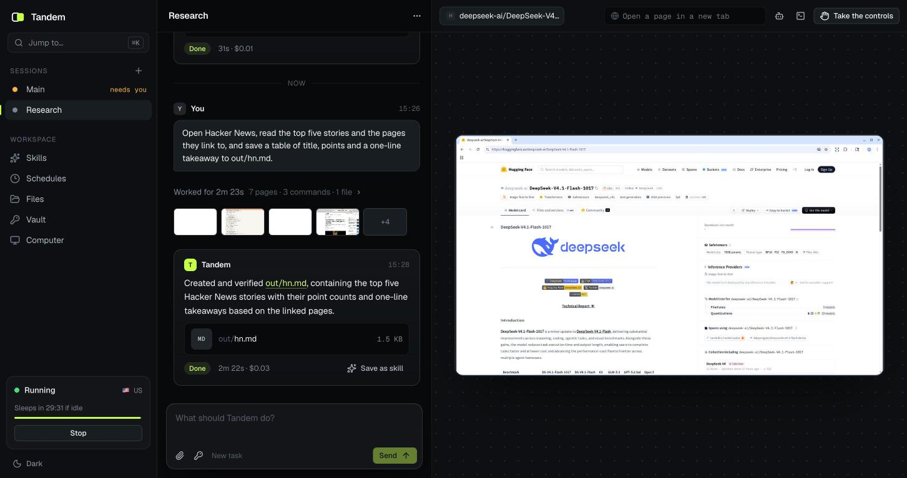
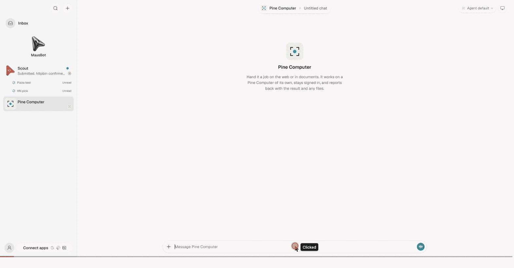
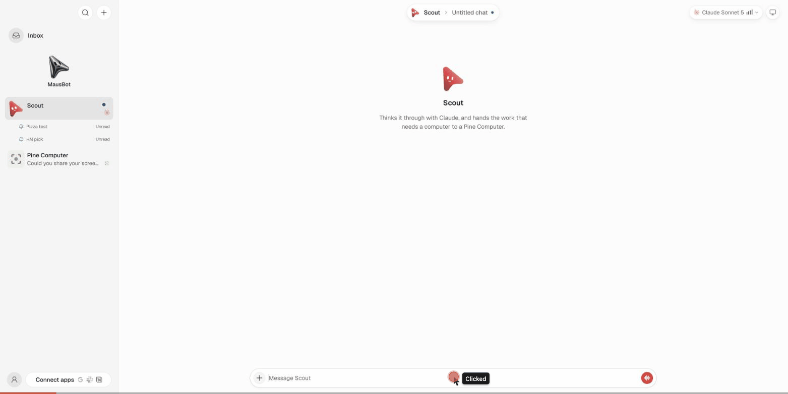

<p align="center">
  <a href="https://pinecomputer.io">
    <picture>
      <source media="(prefers-color-scheme: dark)" srcset="docs/brand/mark-on-dark.svg">
      
    </picture>
  </a>
</p>

<h1 align="center">Pine Computer</h1>

<p align="center">
  <b>Your product. Our computer.</b><br>
  Every agent product is a face and a computer behind it. Pine Computer is the computer, finished:<br>
  a whole cloud computer with an agent built in. Bring the model, the logic and the interface, and build the rest on it.
</p>

<p align="center">
  <a href="https://pinecomputer.io">Website</a> ·
  <a href="https://console.pinecomputer.io/docs">Developer docs</a> ·
  <a href="https://pinecomputer.io/use-cases/">Use cases</a> ·
  <a href="examples/">Built on Pine Computer</a> ·
  <a href="https://discord.gg/gVawMHNde">Discord</a> ·
  <a href="https://x.com/pine_computer">X</a>
</p>

<p align="center">
  
  
</p>

<br>

<p align="center">
  
  <br>
  <sub>A product built on it, from a recorded call: the video agent talks to the customer while the Computer files the claim.</sub>
</p>

<p align="center">
  <a href="#what-a-computer-can-do">What it can do</a> ·
  <a href="#build-it-into-your-product">Build it in</a> ·
  <a href="#built-on-pine-computer">Built on it</a> ·
  <a href="#plugins">Plugins</a> ·
  <a href="#or-over-a-protocol">Protocols</a> ·
  <a href="#status">Status</a>
</p>

<br>

<table>
  <tr>
    <td width="25%" valign="top">
      <h3>A whole computer</h3>
      A browser, a desktop, files, a shell, and document and media tools. It works across websites and business software the way a person at a desk does.
    </td>
    <td width="25%" valign="top">
      <h3>An agent built in</h3>
      Hand over a job, not a script of clicks. Your product keeps its own model, logic and tools, and gets the finished work back.
    </td>
    <td width="25%" valign="top">
      <h3>Stays signed in</h3>
      Sign-ins belong to the Computer. The next job starts where the last one ended, and a job carries on after the chat that started it closes.
    </td>
    <td width="25%" valign="top">
      <h3>Your turn, when it matters</h3>
      It asks before it spends, sends or submits. Watch the live screen, take the controls to type a code or show it how, and hand them back.
    </td>
  </tr>
</table>

<br>

## What a Computer can do

Agents are good at deciding what to do. Most of the world's work still happens behind a sign-in, on a web
page, in a file. Pine Computer is the computer for that work, and it is a whole one.

| | |
| --- | --- |
| **Does the job** | Give it a goal in plain words. It works a real Chrome on a real desktop, across as many tabs as the job needs, with a shell and files beside it. [Agent](https://console.pinecomputer.io/docs/agent) |
| **Shows its work** | Every step streams back as it happens: what it is doing, each action and how it went, and the screen itself. [Agent](https://console.pinecomputer.io/docs/agent) |
| **Asks first** | It stops and asks when only a person knows the answer, and before anything that spends, sends or submits. The answer carries the same job on. Steer it mid-job, or cancel. [Agent](https://console.pinecomputer.io/docs/agent) |
| **Hands you the controls** | Its live desktop sits inside your own page, as a Web Component or a React or Vue component, on a laptop or a phone. A person watches, takes over to sign in or decide, and hands it back. [Web SDK](https://console.pinecomputer.io/docs/web-sdk) |
| **Remembers who it is** | Sign-ins and passkeys belong to the Computer and come back every time it starts, saved under keys only your server holds. [Persistence](https://console.pinecomputer.io/docs/persistence) |
| **Learns the job** | Turn a job it finished, or one a person showed it, into a skill. You read each skill before any agent uses it, and every later job on that Computer starts out knowing how. [Skills](https://console.pinecomputer.io/docs/skills) |
| **Works in parallel** | Several sessions on one Computer at once, each with its own window, shell and files, all sharing the same sign-ins. [Sessions](https://console.pinecomputer.io/docs/sessions) |
| **Makes real files** | Fills, edits and merges PDFs; writes Word documents, PowerPoint decks and Excel workbooks; cuts, subtitles and mixes video and audio. [Skills](https://console.pinecomputer.io/docs/skills) |
| **Keeps what matters** | Artifacts are files the Computer keeps beyond any one session. List, upload and download them even while it is stopped, or share one with a link. [Artifacts](https://console.pinecomputer.io/docs/artifacts) |
| **Keeps secrets** | Hand it a password by name. The Computer types it; the model never sees it. [Agent](https://console.pinecomputer.io/docs/agent) |
| **Waits without running** | Pause a Computer with everything open and carry on later, or stop it and start again from its saved identity. [Persistence](https://console.pinecomputer.io/docs/persistence) |
| **Works from where you choose** | Pick the country its browser reaches the internet from. [Overview](https://console.pinecomputer.io/docs) |

## Build it into your product

All of it is one SDK away. Your backend creates a Computer and hands it a job; your page shows its screen.
The server SDKs are in TypeScript, Go, Ruby and Python, with the same objects and calls in each.

```ts
import { Client, Credentials } from "@pinesandbox/computer";

const client = Client.fromEnv();
const credentials = await Credentials.generate();
await store.saveCredentials(credentials.id, credentials.serialize()); // your encrypted database

const computer = await client.createComputer({ credentials });
const session = await computer.createSession();

// Hand over the job. The password is typed by the Computer and never reaches the model.
const goal = "Sign in to the supplier portal as ops@example.com with $PORTAL_PASSWORD and download this month's invoices.";
let turn = await session.agent.run(goal, {
  idempotencyKey: message.id,
  secrets: { PORTAL_PASSWORD: await vault.get("portal") },
});

// Show the work as it happens.
for await (const event of session.agent.events()) {
  const step = event.activity();
  if (step) upsertStep(step.id, step.state, step.title); // "Click “Log in”"
  if (event.result()) break;
}

// A question ends the turn; the person's reply carries the job on.
turn = await session.agent.wait(turn.turnId);
if (turn.state === "needs_input") turn = await session.agent.answer(turn.turnId, await ask(turn.question));

// Bring the work back, and keep how it was done.
for (const file of turn.result?.artifacts ?? []) await save(file.relativePath, await session.readFile(file.relativePath));
await session.learn(); // a draft skill, waiting for your review
```

```tsx
import { PineDesktop } from "@pinesandbox/computer-web/react";

// The live screen in your page. Your backend mints a short-lived token for it; no key reaches the browser.
<PineDesktop url={url} token={getDesktopToken} control={driving ? "drive" : "view"} />
```

- Server SDK for TypeScript: [`@pinesandbox/computer`](https://www.npmjs.com/package/@pinesandbox/computer)
- Web SDK, the live desktop in your page: [`@pinesandbox/computer-web`](https://www.npmjs.com/package/@pinesandbox/computer-web)
- Every SDK and the full guide: [developer docs](https://console.pinecomputer.io/docs)

The [starter](examples/starter/) is the shortest path from the SDK to a product: a complete app to rename
and ship. A coding agent can build the integration for you with the
[`pine-computer-sdk`](skills/pine-computer-sdk/SKILL.md) skill, which sends it to the guide for the SDK
version you have installed.

<p align="center">
  
  <br>
  <sub>The starter: the agent's work on the left, the Computer's live screen on the right.</sub>
</p>

The SDKs are versioned and released on their own, and their packages are named `pinesandbox`. This
repository works with the SDK's `0.3` line: `@pinesandbox/computer` 0.3.5 or newer, `@pinesandbox/computer-web`
0.3.8 or newer.

## Built on Pine Computer

A workspace of AI coworkers, a personal agent, a studio, a video agent that files the claim while it talks:
each is a face on a computer, and the computer is the hard half. These are whole products with their own
model, logic and interface, open source, on the same Computer. Clone one, rename it, ship it.

| | |
| --- | --- |
| [**Starter**](examples/starter/) | A complete product to rename and ship: sessions side by side, the work live, the controls, skills, a vault, files in and out, schedules. Start here. |
| [**Roster**](examples/coworkers/) | A workspace of AI coworkers, each with a Computer of its own: give one a job in its thread, watch its screen beside the chat, approve when it asks. A coding agent built it from the starter in 39 minutes; [the log](examples/coworkers/docs/BUILD-LOG.md) has every step. |
| [**Tavus video agent**](examples/tavus-video-agent/) | A video agent takes a customer's call and hands the claim to a Pine Computer, which files it while they talk. |
| [**Drama Studio**](https://github.com/PineComputer/open-pinedrama) | A studio for makers of AI vertical short dramas: agents, each on its own Computer, take a screenplay to a cut, and you review where they ask. |

## Plugins

An agent harness decides what should happen and has nowhere for it to happen. Where a harness has a plugin
system, Pine Computer goes in as a plugin built on the SDK, using the harness's own credentials and skills.

| | |
| --- | --- |
| [**DeepSeek Harness**](plugins/deepseek-harness) | A plugin in its own plugin system, with secrets from its credential store. |
| **Claude Code** | The tools and the skill together, [installed from this repository](#or-over-a-protocol). |

## Or over a protocol

`pine-computer` is a CLI, built on the same SDK, that puts one Computer behind the protocols agent apps
already speak. You run it with your own key.

| | For | What the app sees |
| --- | --- | --- |
| **A tool** · `pine-computer mcp` | Agents that call tools | Four tools: `computer_task`, `computer_wait`, `computer_cancel`, `computer_desktop` |
| **A server** · `pine-computer serve` | Web apps and agent platforms, over HTTP | The same tools at `/mcp`, an A2A agent at `/a2a` with its card, and an AG-UI agent at `/agui` |
| **A coworker** · `pine-computer acp` | Apps that run agents over the Agent Client Protocol | A bot. Each chat thread is a thread on the Computer; its steps show as it works; its summary is the reply |
| **The terminal** · `pine-computer run "…"` | You | One job, its steps as it goes |

You need a Pine Computer project key ([pinecomputer.io](https://pinecomputer.io)) and Node.js 22 or newer.

```sh
git clone https://github.com/PineComputer/pine-computer && cd pine-computer
npm install && npm run build && npm link          # puts `pine-computer` on your PATH

mkdir -p ~/.pine-computer && chmod 700 ~/.pine-computer
printf 'PINE_SANDBOX_API_KEY=…\nPINE_SANDBOX_ENDPOINT=…\n' > ~/.pine-computer/env && chmod 600 ~/.pine-computer/env

pine-computer run "Open https://news.ycombinator.com and tell me the top 3 stories."
```

Claude Code, as a plugin:

```
/plugin marketplace add PineComputer/pine-computer
/plugin install pine-computer@pine-computer
```

Any agent with an MCP setting:

```json
{ "mcpServers": { "pine-computer": { "command": "pine-computer", "args": ["mcp"] } } }
```

<table>
  <tr>
    <td width="50%" valign="top">
      <br>
      <sub><b>As a coworker:</b> a bot in the chat, with its own screen.</sub>
    </td>
    <td width="50%" valign="top">
      <br>
      <sub><b>As a tool:</b> another agent hands the job over and relays the question.</sub>
    </td>
  </tr>
</table>

Through a protocol a job still streams its steps, asks its question, keeps its thread, shows its live
desktop on a page of its own, brings files back and takes secrets by name. Skills, artifacts, parallel
sessions and the desktop inside your own interface come with the SDK. [`docs/cli.md`](docs/cli.md) is the
full reference, and [`skills/pine-computer`](skills/pine-computer/SKILL.md) teaches an agent when and how to
hand work over.

## Status

What has been run end to end:

| | State |
| --- | --- |
| Claude Code, over MCP | Run |
| Codex, over MCP | Run |
| OpenMausBot, as a coworker (ACP) and as a tool (MCP) | Run |
| A2A agent and hosted MCP (`pine-computer serve`) | Run against the protocol's own clients |
| CopilotKit OpenBot, over AG-UI (`pine-computer serve`) | Run against the protocol's own client; not yet run inside OpenBot |
| Cursor, Claude Desktop, nightly-labs OpenBot | Configuration given, not yet run by us |
| DeepSeek Harness plugin | Loads in dsh, with its tools and skill registered; no job run through it yet |

## License

[Apache-2.0](LICENSE). Built by [Pine AI](https://pinecomputer.io).
