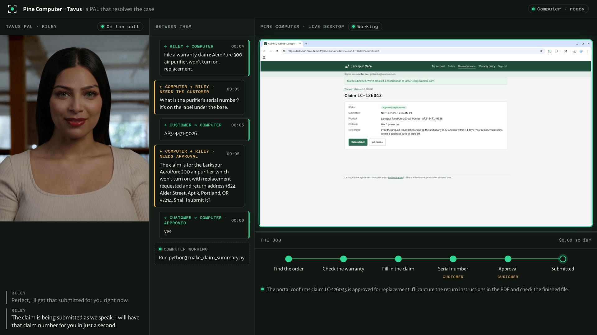

# Pine Computer × Tavus: a PAL that resolves the case

A Tavus PAL talks to a customer; a Pine Computer does the work. The customer asks for a warranty claim, the
PAL starts it, and the Computer signs in to a support portal, reads the warranty PDF, finds the order and fills in
the claim. It needs the serial number, which only the customer has, so the PAL asks. The customer can hang up to
find it: the claim waits, signed in. When they call back, the PAL picks up the thread, reads the claim back, gets
a clear yes, and the Computer submits. The claim number is checked against the portal's own records, and a PDF
summary comes back.



Everything is real except the portal: Pine's server SDK and Web SDK, Tavus's conversation API and interaction
protocol, and a synthetic support site (`portal/`) that behaves like the real kind.

```
 Customer ── voice/video ──▶ Tavus PAL (Riley)
                               │  conversation.tool_call  (app message)
                               ▼
 This page ── POST /api/tool ─▶ this server ── session.agent.run / answer ──▶ Pine Computer ──▶ Larkspur Care portal
      ▲                          │                 agent.wait → needs_input / completed
      │ conversation.tool_result │                 agent.events → steps
      │ append_llm_context +     │
      └── respond (a "nudge") ◀──┘  ◀── /api/live (server-sent events)
 <PineDesktop>  ◀── delegateDesktop token ── the live screen; Take over / Hand back
```

## Run the demo

Open http://127.0.0.1:3100 in Chrome. You play the customer, Jordan Lee; the panel under Riley always shows your
next line, with **Say it for me** to type it into the call when the mic or the room is a problem.

1. **Start the call.** The Computer starts too. In the call window, allow camera and microphone, click **Join**.
2. Tell Riley your AeroPure 300 purifier won't turn on and you'd like a replacement. She starts the claim: the
   middle column shows the handoff, the desktop on the right goes to work, the tracker below follows the job.
3. About a minute in, the Computer needs the serial number. Riley asks. Say you'll go find it, and **Hang up**.
   The claim waits, signed in and filled in.
4. **Call back.** Riley picks up the thread. Give the number (`AP3-4471-9026`), then say yes when she reads the
   claim back. The claim number comes back, confirmed in the portal's own records, with a PDF summary.
5. **New demo** resets the claim and the portal for the next run.

## The three tools

| Tool | What the server does | Returns to the PAL |
| --- | --- | --- |
| `start_warranty_claim(product, issue, details?, resolution?)` | Clears the agent's memory, `agent.run(goal, { secrets })` | at once: "Started…" |
| `answer_claim_question(answer)` | `agent.answer(turnId, answer)` | at once: "Passed on…" |
| `get_claim_status()` | reads the case | where it stands |

The tools never wait for the work. A follower in the server waits on the turn (`agent.wait`); when the agent
asks a question or finishes, the server sends the page a nudge, and the page adds it to the PAL's context
(`conversation.append_llm_context`) and prompts a reply (`conversation.respond`), once per conversation and only
when nobody is mid-sentence. If no call is live, the next call carries it: `conversational_context` and
`custom_greeting` are built from the case when the conversation is created (`src/server/tavus.ts`).

The goal Pine's agent works toward is in `src/server/claim.ts`. It asks for the serial number and stops on the
review page for approval before submitting. The password goes in as a Pine secret (`$PORTAL_PASSWORD`): the agent
types it without the model ever seeing it.

## Run it

You need Node.js 22+, a Pine Computer project key, and a Tavus API key.

```sh
npm install
cp .env.example .env.local      # fill in the Pine key, DEMO_SECRET, TAVUS_API_KEY, TAVUS_FACE_ID, PORTAL_STAFF_KEY
npm run setup:tavus             # creates the three tools and the PAL; put the TAVUS_PAL_ID it prints in .env.local
npm run dev                     # http://127.0.0.1:3100   (add ?operator for the fallback panel; Alt+O toggles it)
```

`npm run rehearse` runs the whole claim without Tavus, through the same tools, answering as the customer would,
and prints timings. `npm run rehearse -- --hangup 120` waits two minutes on the first question, like a call-back.

The app listens on 127.0.0.1 only and has no sign-in: it's a demo station, not a service.

### The portal

`portal/` is a Cloudflare Worker: Larkspur Care, at https://larkspur-care-demo.19pine.workers.dev. Sign in as
`jordan.lee@example.com` / `AeroPure-2026`. Three orders: an AeroPure 300 purifier bought Mar 2, 2026 (in
warranty; serial `AP3-####-####`, not on file), a filter pack (consumable, not covered), and a fan from 2024
(expired). The claim form refuses a malformed serial number; the review page holds the claim until Submit.

The staff console (`/staff?key=…`, key in `.portal-staff-key.local`) lists claims, resets the demo, signs every
device out (for a sign-in-once beat), and can require a text-message code at sign-in (the code shows there), for a
take-over beat.

```sh
cd portal
npx wrangler deploy                          # CLOUDFLARE_ACCOUNT_ID set
node scripts/smoke.mjs                       # walks the portal like the agent; PLAYWRIGHT / CHROMIUM point at a browser
node scripts/make-pdfs.mjs                   # rebuilds the warranty PDF and receipts
```

## Before the meeting

- [ ] `npm run rehearse` passes three times in a row (exit 0: submitted and confirmed in the portal).
- [ ] One full rehearsal with the PAL, spoken, including the hang-up and call-back, recorded as the backup
      with the PAL's voice (OBS: a macOS Screen Capture source plus an Application Audio Capture of the browser;
      QuickTime alone records no system audio).
- [ ] If the room is noisy or the mic fails, type the customer's lines in the operator panel (**Say as the
      customer**): the PAL answers them as if spoken. `?muted` joins without camera or microphone.
- [ ] `?captions` shows what Riley and the customer just said in a bar at the bottom: use it on a projector in a
      loud room, and for recordings.
- [ ] Press **Start the Computer** (or `rehearse`) 10 minutes before: a new Computer starts in seconds, but don't
      spend them on stage.
- [ ] Reset the case and the portal from the operator panel. Leave the Computer signed in.
- [ ] Roles: one person drives the call (the customer), one watches the operator panel, one tells the story.

**Timing from the rehearsals** (Pine side, Nov 6): first question at ~1–1.5 min, approval ~10 s after the answer,
submitted ~25 s after the yes. About $0.14 a claim in model and compute.

**If something goes wrong**, in this order: answer the question from the operator panel (the PAL hears about it
on its next turn); take over the desktop and finish the step by hand, then hand back; play the recording; show
the steps and the staff view as the trace.

## Record a film

`npm run record` (with `npm run dev` running) records one whole call as a film: the page at twice its size,
with both voices.

```sh
npm run voice                                                    # once: the customer's lines, into recordings/voice
npm run record -- --voices recordings/voice --out recordings/take.mp4
```

- **The customer is a set of voice clips made before the take** (`--voices`: a folder with `1.wav` … `5.wav`,
  the lines listed at the top of `scripts/record.mjs`). Each is played into the call as the microphone, so the
  PAL hears and answers it, and each waits until the PAL has finished asking. Without `--voices` the system
  voice reads the lines, which is only good for checking the timing.
- **`npm run voice` makes the clips** with ElevenLabs (`ELEVENLABS_API_KEY` in `.env.local`): a voice from its
  library, the lines written the way a person talks, and the sound of a caller's microphone. `--voice <id>`
  picks another voice. Listen to them before a take; any five WAV files of the lines work as well.
- **One call by default.** `--callback` has the customer hang up to find the serial number and call back.
- **`?film` is the page as it is recorded:** no operator's controls, the PAL as a picture filling its panel,
  the desktop edge to edge, and the last two lines of the call under the PAL. The page without `?film` is
  unchanged: your own camera and microphone, in the call's own window.
- The picture comes from the frames Chrome paints and the sound is mixed inside the call, so no
  screen-recording permission is needed and the machine stays silent. It needs `ffmpeg` (set `FFMPEG` to use
  another one).

A take uses about four minutes of Tavus conversation time.

## Known limits

- A question waits only while the Computer runs. Work pushes its stop time out an hour
  (`DEMO_IDLE_TIMEOUT_SECONDS`); waiting doesn't. The operator panel shows when it stops.
- Stop/Start keeps the sign-in (saved browser state) but ends the session and its open question; the case shows
  "stopped" and can be started again.
- The page relays the PAL's tool calls, so the page that hosts the call must stay open.
- The approval question is recognised by the word "submit"; the goal asks the agent to end it with "Shall I
  submit it?".
- Tavus drops bracketed text from a `conversation.respond`, so the page's updates start with the plain words
  "Claim task update, from the computer, not the customer:", which the PAL's prompt tells it to recognise.
- Daily shows its camera check before each call: the customer clicks **Join**. The page joins as "Jordan Lee".

Tested live on Nov 6, 2026: a full run with the real PAL and a real Computer, including the hang-up and the
call-back, ended with the claim submitted and confirmed in the portal. The customer's lines were typed into the
call (operator panel, **Say as the customer**); a spoken run is the next rehearsal.
