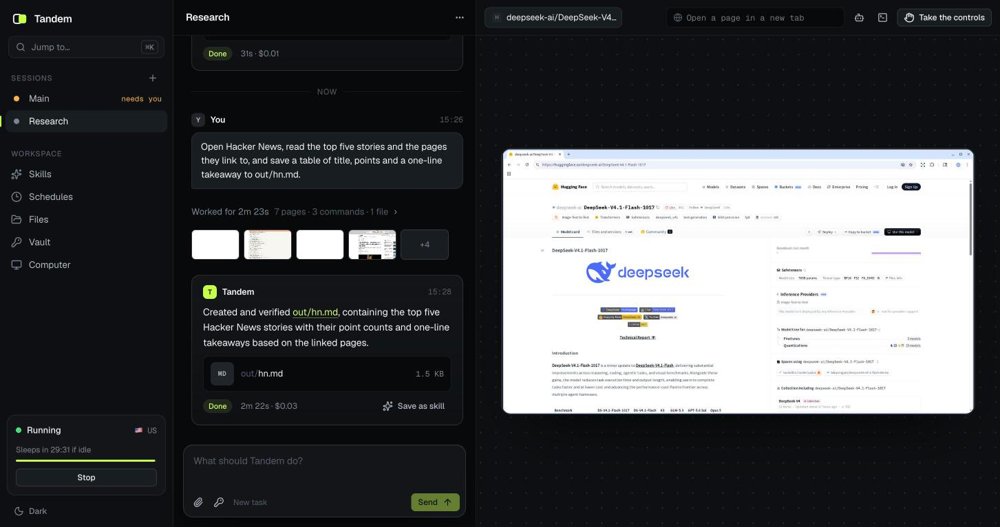
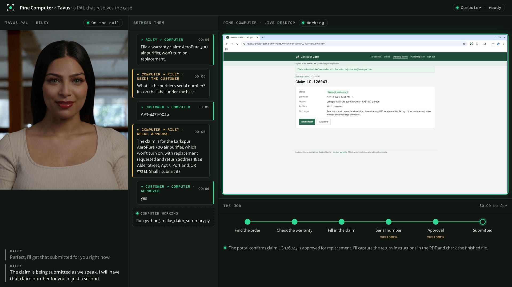

# Built on Pine Computer

Real products that hand their work to a Pine Computer. Each keeps its own model, its own logic and its own
interface; the Computer does the work that needs a computer. Each folder here is a whole app: open it,
read its README, run it.

## In a product

Built on the SDKs: the product creates a Computer, hands it a job, shows its screen and brings the work back.

| | What it is | Stack |
| --- | --- | --- |
| [**Starter**](starter/) | A complete product to rename and ship: sessions side by side, the work live, the controls, skills, a vault, files in and out, schedules. Start here. | Next.js, the TypeScript and Web SDKs |
| [**Drama Studio**](https://github.com/PineComputer/open-pinedrama) | A studio for makers of AI vertical short dramas. Drop in a screenplay; agents, each on its own Computer, make the bible, the cast, the storyboards, the takes and the cut, and you review where they ask. A product of its own, in its own repository. | Node.js, a desktop app |
| [**Tavus video agent**](tavus-video-agent/) | A video agent takes a customer's call and hands the warranty claim to a Pine Computer, which files it in a support portal while they talk. Includes a recorder that films a whole call. | Next.js, Tavus, Daily |

## In an agent workspace

The Computer as a tool: the workspace's own agent stays in charge and hands over the computer work.

| | How | Guide |
| --- | --- | --- |
| **Claude Code** | The plugin from this repository: the tools and the skill together | [README](../README.md#get-started) |
| **Codex, Cursor** | `pine-computer mcp` | [README](../README.md#get-started) |
| **DeepSeek Harness** | A plugin in its own plugin system | [plugins/deepseek-harness](../plugins/deepseek-harness) |
| **OpenMausBot** | An MCP server a bot is given | [docs/cli.md](../docs/cli.md#openmausbot) |

## As a coworker

The Computer as a bot of its own, in a chat app of bots: a thread is a job, its steps show as it works, a
thumbs-up answers its question.

| | How | Guide |
| --- | --- | --- |
| **OpenMausBot** | An engine over the Agent Client Protocol | [docs/cli.md](../docs/cli.md#openmausbot) |
| **nightly-labs OpenBot** | A custom ACP agent | [docs/cli.md](../docs/cli.md#nightly-labs-openbot) |

[docs/showcase/](../docs/showcase/) has both shapes on the same job, recorded in OpenMausBot.

## Where these live

The starter and the Tavus video agent are developed here: change them in this repository. Drama Studio is a
product with a repository of its own.
