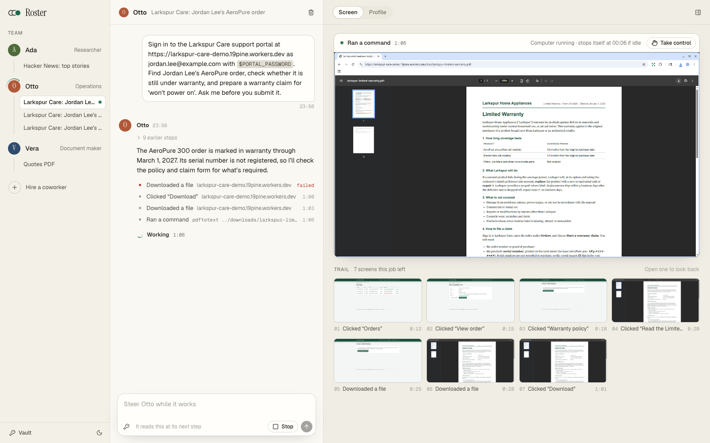
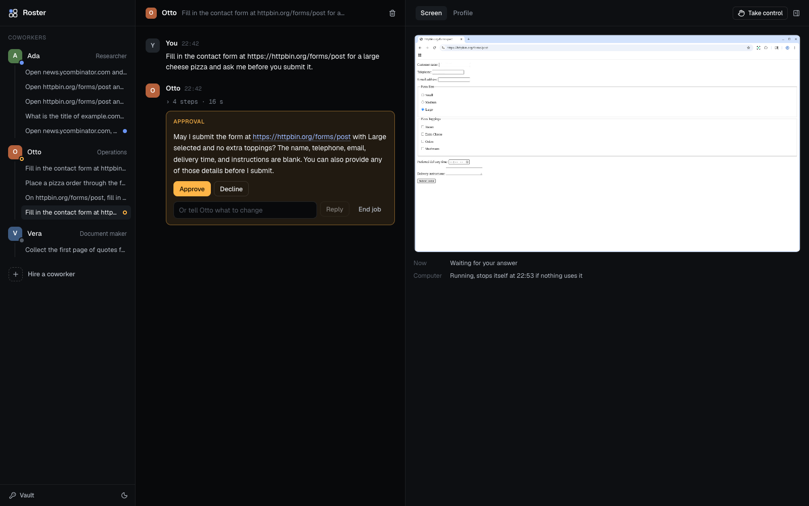
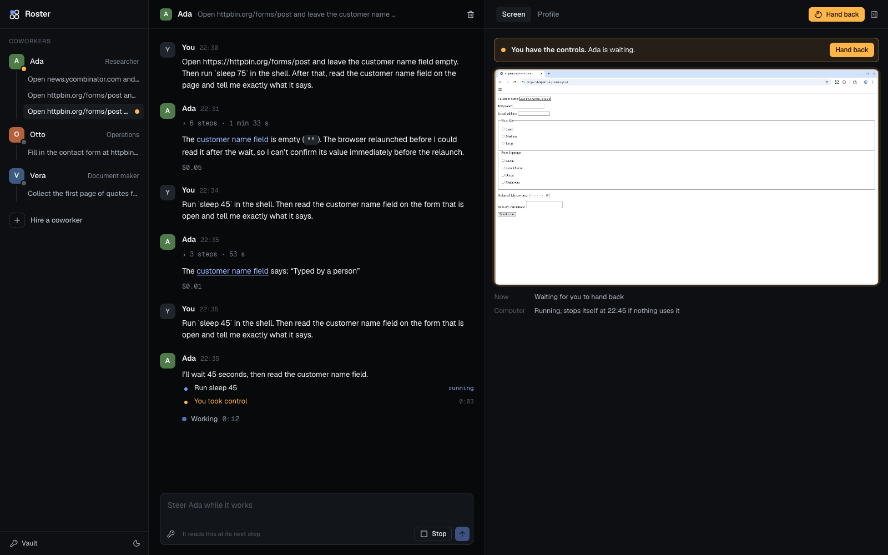
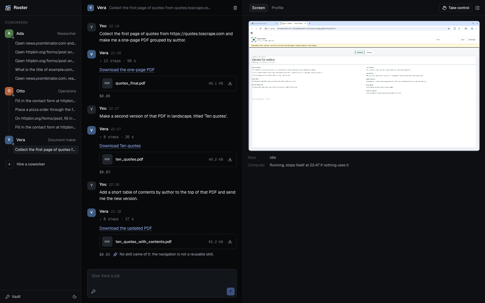
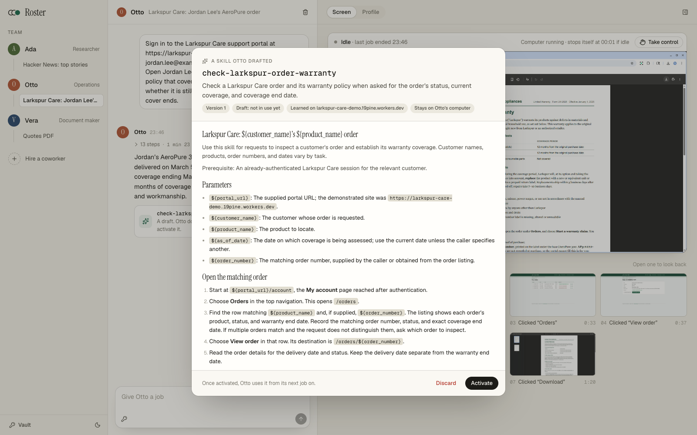
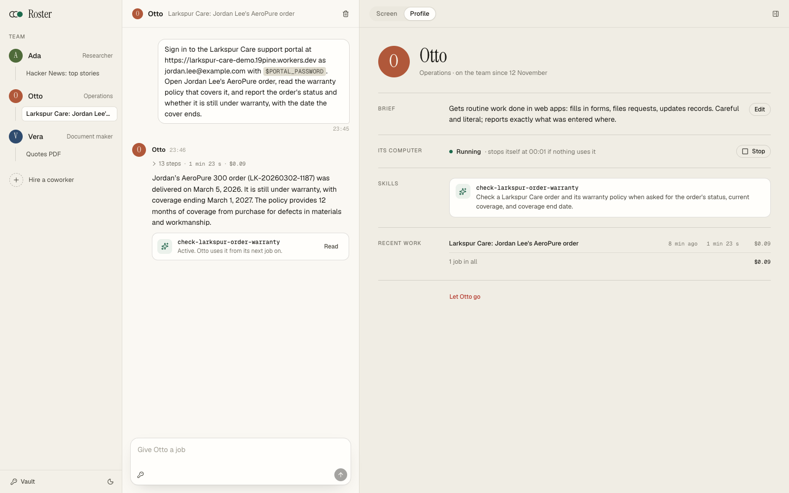

# Pine Computer coworkers

A team chat where some of the members are AI coworkers, and each coworker has a computer
of its own. Built on [Pine Computer](https://pinecomputer.io): every coworker gets its own
Computer, with its own sign-ins, files and learned skills, and Pine's agent does the work.
There is no model key in this app.

It ships as **Roster**, a name to replace: rename it in [`src/brand.ts`](src/brand.ts),
change `--accent` in [`src/app/globals.css`](src/app/globals.css) (one colour, set once for
light and once for dark), and it's yours. It is light by default and follows the system
into dark, or the toggle in the sidebar. It is
the [starter](../starter) rearranged around many Computers instead of one, on the same
two SDKs: the TypeScript server SDK,
[`@pinesandbox/computer`](https://www.npmjs.com/package/@pinesandbox/computer), and the Web
SDK, [`@pinesandbox/computer-web`](https://www.npmjs.com/package/@pinesandbox/computer-web).



## What it does

| Feature | What a person does | How it's built | Where |
| --- | --- | --- | --- |
| **Coworkers** | Start with three (a researcher, an operator, a document maker) and hire more with a name, a role and a brief | A record per coworker; the role and brief go with every job as the run's `context` | [`src/server/seed.ts`](src/server/seed.ts), [`src/server/jobs.ts`](src/server/jobs.ts) |
| **A Computer each, created lazily** | Nothing: a coworker's first job creates its Computer, later jobs reuse it, and it stops itself when idle | `createComputer` on first use, `reconnectComputer` from saved records, `startComputer` after a stop, `idleTimeoutSeconds` | [`src/server/pine.ts`](src/server/pine.ts) |
| **Threads** | Message a coworker; follow up in the same thread; run several threads at once. A thread names itself from its first message ("Hacker News: top stories", "Quotes PDF") | A thread is one session (`createSession`, `adoptSession`); a message is `agent.run` with an idempotency key. The title is a rule, not a model call | [`src/server/jobs.ts`](src/server/jobs.ts), [`src/shared/title.ts`](src/shared/title.ts), [`api/threads/[thread]/jobs`](src/app/api/threads/[thread]/jobs/route.ts) |
| **The work, live** | Watch its steps arrive in plain words ("Opened 5 pages", "Ran a command"), then settle into one line ("12 steps · 1 min 40 s · $0.09") that opens again | `agent.events()` relayed as a resumable server-sent stream; steps of one kind in a row fold into one | [`…/events`](src/app/api/threads/[thread]/events/route.ts), [`src/shared/fold.ts`](src/shared/fold.ts), [`src/shared/steps.ts`](src/shared/steps.ts) |
| **The trail** | Under the screen, a strip of the screens the job left, each with its step and time; open one to look back, also after the Computer has stopped | The stream's `frame` events, each tied to its step; kept beside the job when it ends, read back with `agent.eventsPage` | [`src/server/wire.ts`](src/server/wire.ts), [`src/server/turns.ts`](src/server/turns.ts), [`api/jobs/[job]/shots`](src/app/api/jobs/[job]/shots/[name]/route.ts) |
| **Questions and approvals** | Reply under its question; Approve or Decline in one tap when it asks before it spends, sends or submits | A turn that ends `needs_input`; `agent.answer` naming that turn. The context tells it to ask and to mark approvals | [`src/ui/thread/Conversation.tsx`](src/ui/thread/Conversation.tsx), [`src/shared/api.ts`](src/shared/api.ts) |
| **Steer and stop** | Send a message while it works, or stop it | `agent.steer`, `agent.cancel` | [`api/threads/[thread]/jobs/[job]`](src/app/api/threads/[thread]/jobs/[job]/route.ts) |
| **The screen, and control** | See the coworker's desktop beside the thread; take control, drive, hand back | `delegateDesktop` into `<PineDesktop>`; `takeControl` / `releaseControl`; `controlEvents()` | [`src/ui/thread/Screen.tsx`](src/ui/thread/Screen.tsx), [`…/control`](src/app/api/threads/[thread]/control/route.ts) |
| **Files** | Open or download what a job made, also after its Computer has stopped | Each file in the turn's `result.artifacts`, streamed with `openFile` into the app's own storage | [`src/server/turns.ts`](src/server/turns.ts), [`api/jobs/[job]/files`](src/app/api/jobs/[job]/files/[...path]/route.ts) |
| **Teach it** | "Save as a skill" under a finished job; answer what the author asks, if it asks; read the draft; activate it | `session.startLearn({ scaffold })` in the background and `authorEvents` for its outcome and questions, then `skills.version`, `skills.activate` | [`src/server/jobs.ts`](src/server/jobs.ts), [`src/ui/thread/SkillDraft.tsx`](src/ui/thread/SkillDraft.tsx) |
| **Profile** | See a coworker's role, brief, Computer (start, stop), skills, recent work and what each job cost | `stop()`, `sandboxDetails()`, `skills.list()`, each turn's `usage.cost` | [`src/ui/coworker/Profile.tsx`](src/ui/coworker/Profile.tsx) |
| **Vault** | Keep secrets for the workspace and use one in a message as `$NAME` | `secrets` on every run, answer and steer, sealed at rest; the chat only ever holds the name | [`src/server/vault.ts`](src/server/vault.ts) |
| **The queue** | Nothing: a job that can't start yet says why in the thread and starts when there's room | `CapacityExceededError` and the session limit from `capabilities()` put the job in a queue the worker retries | [`src/server/jobs.ts`](src/server/jobs.ts), [`src/server/worker.ts`](src/server/worker.ts) |

A question, with one-tap approval:



Taking control of its Computer while it waits:



A finished job, with the PDF it made open where the screen was:



A skill drafted from a finished job, read before it is activated, and the profile that lists it:





## Run it

You need Node.js 22 or later and a Pine Computer project with an API key, from the
[Console](https://console.pinecomputer.io).

```sh
cd examples/coworkers
npm install
cp .env.example .env.local   # then add your project's API key and a COWORKERS_SECRET
npm run dev
```

Open <http://localhost:3000> and hand one of the three coworkers its suggested first job.

| Setting | |
| --- | --- |
| `PINE_SANDBOX_ENDPOINT`, `PINE_SANDBOX_API_KEY` | Your project's endpoint and key, from the console. |
| `COWORKERS_SECRET` | Encrypts what the app keeps about its Computers: `openssl rand -base64 32`. |
| `COWORKERS_DATA_DIR` | Where it keeps its records and copied files. Default `.data/`. |
| `COWORKERS_IDLE_SECONDS` | How long a coworker's Computer may sit idle before it stops itself. Default 600. |

## How it fits together

```
Browser                         This app's server                                   Pine
───────                         ─────────────────                                   ────
Composer      ── message ─────▶ POST /api/threads/:t/jobs ── record, then launch:
                                                             ensureComputer(coworker) ──▶ its Computer
                                                             ensureSession(thread)    ──▶ its session
                                                             agent.run(goal, context) ──▶ a turn
EventSource   ◀── steps ─────── GET  /api/threads/:t/events ── agent.events()        ◀── activity
<PineDesktop> ── token ───────▶ POST /api/threads/:t/desktop ─ delegateDesktop       ──▶ screen
Reply/Approve ── answer ──────▶ POST /api/threads/:t/jobs/:j ─ agent.answer          ──▶ next turn
EventSource   ◀── changes ───── GET  /api/live  ◀── the worker ─ agent.wait()        ◀── outcome
                                .data/  per coworker: credentials and binding (sealed);
                                        per thread: the session token (sealed);
                                        per job: the ask, steps, answer, cost, files
                                                 and the screens it left
```

- **Every record is keyed by coworker.** A coworker's Computer has its own credentials and
  binding; a thread's session token belongs to that Computer's current binding. Two
  coworkers never share a browser profile, a sign-in or a skill.
- **A job is recorded before it starts.** Starting a Computer takes a moment, so the
  request answers at once and the launch runs in the background; the job's key is the
  run's idempotency key, so a retry (or the worker after a restart) can't start it twice.
- **The worker** ([`src/instrumentation.ts`](src/instrumentation.ts)) runs in the server
  process: it follows each running job with `agent.wait`, keeps its steps, answer and
  files, launches queued jobs, and notices a Computer that idled out.
- **A stopped Computer loses its sessions, not its history.** The next message in a thread
  starts the Computer from its saved state, opens a new session, and tells the agent what
  the thread already covered.
- **The server holds every secret.** The project key, each Computer's credentials and
  binding, session tokens and vault values never reach a browser, which only ever holds a
  two-minute desktop token.
- **Approval is the app's rule, not the agent's habit.** Every job's context says to stop
  before spending, sending or submitting and to mark the question; the thread turns that
  mark into Approve and Decline.
- **One person, one machine.** The app answers only on `127.0.0.1`, and only to its own
  pages ([`src/proxy.ts`](src/proxy.ts)).

## Before you ship something like it

- **Add your sign-in** in [`src/proxy.ts`](src/proxy.ts) and key the store by workspace.
- **Move the records to your database**, the files to object storage, and the encryption
  key to your secret manager.
- **Run one worker.** It lives in the server process here; with several processes, run it
  once (a job queue, or a lock), and keep the event streams on a long-lived server.
- **Budget the Computers.** Each coworker's Computer counts toward your project's limit
  while it runs. The idle timeout is what keeps a large team cheap; set it to how long a
  question may reasonably wait for its answer.

## Develop

```sh
npm run check   # typecheck and tests
npm run build
```

## License

[Apache-2.0](LICENSE), like the SDKs it's built on.
