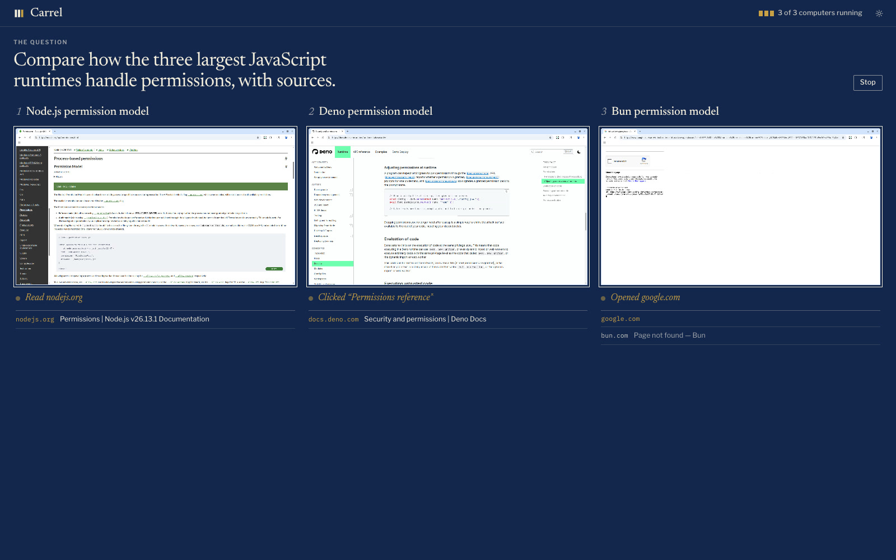
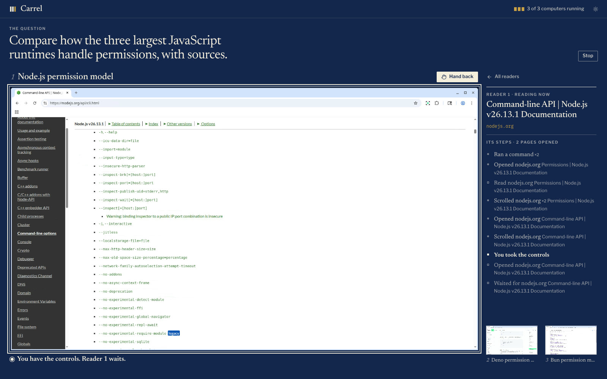
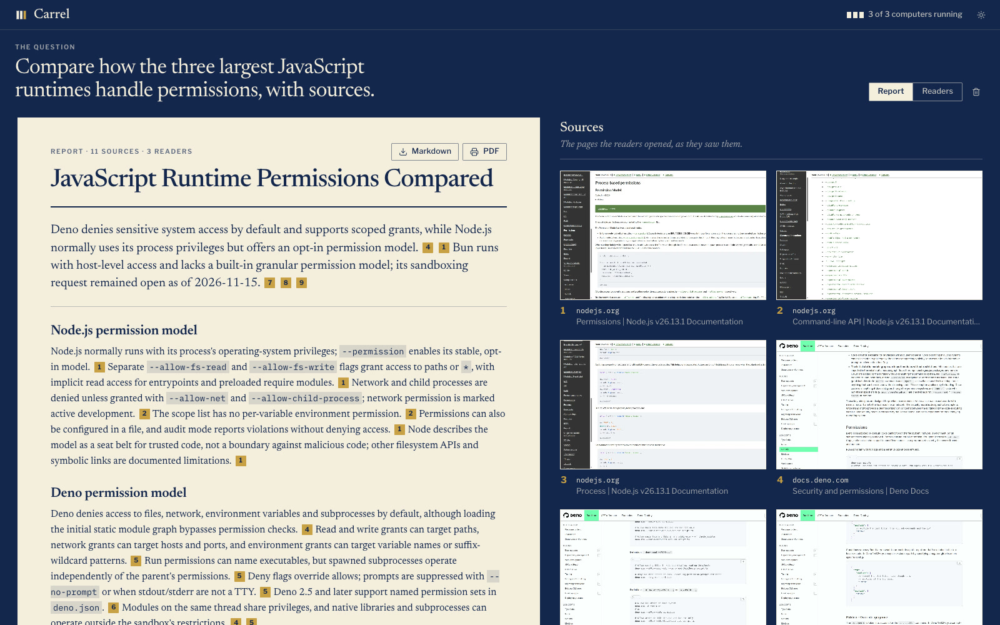

# Carrel: a research desk on Pine Computer

A research desk built on [Pine Computer](https://pinecomputer.io). Ask one question that
takes reading across the web. The desk splits it into angles and puts three Pine
Computers on it at the same time, one angle each, then writes one report whose every
source is a page a reader really opened.

It is the [starter](../starter) taken in one direction: several Computers at once on one
job, built on the TypeScript server SDK,
[`@pinesandbox/computer`](https://www.npmjs.com/package/@pinesandbox/computer), and the Web
SDK, [`@pinesandbox/computer-web`](https://www.npmjs.com/package/@pinesandbox/computer-web).
Rename it in [`src/brand.ts`](src/brand.ts), change `--accent` in
[`src/app/globals.css`](src/app/globals.css), and it's yours.



## What it does

| Feature | What a person does | How it's built | Where |
| --- | --- | --- | --- |
| **A brief** | Ask a question; read the two or three angles a reader proposes; change them; Start | One short `agent.run` that returns `angles.json`, read back with `readFile` and checked before it is shown | [`src/server/desk.ts`](src/server/desk.ts), [`src/ui/brief/Angles.tsx`](src/ui/brief/Angles.tsx) |
| **Three readers at once** | Watch three Computers read at the same time, one angle each | One Computer per reader, one fresh session per run, `agent.run` with the run's id as its idempotency key | [`src/server/pine.ts`](src/server/pine.ts), [`src/server/desk.ts`](src/server/desk.ts) |
| **The wall** | See every reader's live screen, its angle, and the page it is on right now | `delegateDesktop` into `<PineDesktop>`, three at once; `agent.events({ frames: false })` for every reader on one server-sent stream | [`src/ui/brief/Wall.tsx`](src/ui/brief/Wall.tsx), [`api/briefs/[brief]/events`](src/app/api/briefs/[brief]/events/route.ts) |
| **One reader, opened** | Open any screen large, with its steps in plain words; the others keep working in the corner | The same live connection, laid out again, so nothing reconnects | [`src/ui/brief/Wall.tsx`](src/ui/brief/Wall.tsx), [`src/shared/steps.ts`](src/shared/steps.ts) |
| **The controls** | Take a reader's controls (a cookie wall, a sign-in), hand them back; answer a question it stopped on | `takeControl` / `releaseControl`, `control` flipped in place on the element; `agent.answer` | [`api/runs/[run]/control`](src/app/api/runs/[run]/control/route.ts), [`…/answer`](src/app/api/runs/[run]/answer/route.ts) |
| **The report** | Read a short answer and a section per angle, with numbered citations | A last `agent.run` writes `report.json` from the readers' notes; its citations are checked against the numbered sources | [`src/shared/notes.ts`](src/shared/notes.ts), [`src/ui/brief/Report.tsx`](src/ui/brief/Report.tsx) |
| **Sources you can check** | Click a citation and see the reader's screen on that page | Each run's events are read back with `agent.eventsPage` when it ends; the page a browser step ended on, and the frame it left, become a source. A claim that cites a page no reader opened is dropped | [`src/server/turns.ts`](src/server/turns.ts), [`src/shared/notes.ts`](src/shared/notes.ts) |
| **Export** | Download the report as Markdown, or save it as a PDF | A route that writes the file from the kept record; a print view and the browser's Print dialog | [`api/briefs/[brief]/report`](src/app/api/briefs/[brief]/report/route.ts), [`src/ui/brief/PrintView.tsx`](src/ui/brief/PrintView.tsx) |
| **The queue** | See plainly why a reader hasn't started, and carry on | `CapacityExceededError` and `CreateRateLimitedError` become a waiting run; the worker starts it when a Computer is free, on a reader that has finished if there is one | [`src/server/pine.ts`](src/server/pine.ts), [`src/server/worker.ts`](src/server/worker.ts) |
| **Briefs that outlive the Computers** | Open an old brief: its report, its steps and every source's screen are still there | The worker follows each turn with `agent.wait` and copies what it left into `.data/` | [`src/server/turns.ts`](src/server/turns.ts), [`src/server/worker.ts`](src/server/worker.ts) |
| **Computers on demand** | Nothing: a reader's Computer is created when first needed, reused for the next brief, and stops itself when idle. Or stop one from the bar | `createComputer`, `startComputer` from saved credentials, `idleTimeoutSeconds`, `stop` | [`src/server/pine.ts`](src/server/pine.ts), [`src/ui/app/Readers.tsx`](src/ui/app/Readers.tsx) |

Everything changes live: the server pushes what happened and every view updates.

| | |
| --- | --- |
|  |  |

## Run it

You need Node.js 22 or later and a Pine Computer project with an API key. Pine Computer
is in private beta: [request access](https://pinecomputer.io).

```sh
npm install
cp .env.example .env.local   # then add your project's API key and a CARREL_SECRET
npm run dev
```

Open <http://localhost:3000> and ask a question, or choose one of the three it offers.

| Setting | |
| --- | --- |
| `PINE_SANDBOX_ENDPOINT`, `PINE_SANDBOX_API_KEY` | Your project's endpoint and key, from the console. |
| `CARREL_SECRET` | Encrypts what the app keeps about its Computers: `openssl rand -base64 32`. |
| `CARREL_DATA_DIR` | Where it keeps its records and the screens its readers saw. Default `.data/`. |
| `CARREL_IDLE_SECONDS` | How long a reader's Computer may sit idle before it stops itself. Default 600. |

A brief runs three Computers at once. If your project may run fewer, the readers that
can't start say so and wait their turn.

## How it fits together

```
Browser                          This app's server                                 Pine
───────                          ─────────────────                                 ────
<PineDesktop> ×3 ── token ─────▶ POST /api/runs/:r/desktop ──── delegateDesktop ──▶ three screens
EventSource     ◀── events ───── GET  /api/briefs/:b/events ─── agent.events() ×3 ◀── activity
EventSource     ◀── changes ──── GET  /api/live   ◀── the worker ── agent.wait()   ◀── turns
Ask, Start      ── brief ──────▶ POST /api/briefs[/:b] ──────── agent.run(key)    ──▶ plan, read ×3, write
                                 .data/  each reader's credentials, binding and session token (sealed),
                                         briefs, runs, and the screen of every page a reader opened
```

- **A brief is five jobs in plain words.** One run proposes the angles, one run per angle
  reads, one run writes. Each is a goal handed to Pine's agent with the result asked back
  as a small JSON file; nothing scripts the browser. The words are in
  [`src/server/desk.ts`](src/server/desk.ts).
- **Nothing a run returns is trusted until it is checked.** The angles, the notes and the
  report are parsed in [`src/shared/notes.ts`](src/shared/notes.ts). A source is numbered
  only if a reader's browser was on that page, and a citation survives only if it names a
  numbered source.
- **The server holds every secret.** The project key, each Computer's credentials and
  binding and each session token never reach a browser, which only ever holds a
  two-minute desktop token.
- **Every request rebuilds its Computer** from saved records, so a restart carries on
  where the last process stopped.
- **The worker** ([`src/instrumentation.ts`](src/instrumentation.ts)) runs in the server
  process: it records finished runs, moves each brief to its next stage, launches queued
  runs and notices Computers that stopped.
- **One person, one machine.** The app answers only on `127.0.0.1`, and only to its own
  pages ([`src/proxy.ts`](src/proxy.ts)).

## Before you ship something like it

- **Add your sign-in** in [`src/proxy.ts`](src/proxy.ts), and keep one desk (its readers
  and their Computers) per user or workspace.
- **Move the records to your database**, the screens to object storage, and the
  encryption key to your secret manager.
- **Run one worker.** It lives in the server process here; with several processes, run it
  once (a job queue, or a lock), and keep the event streams on a long-lived server.
- **Decide what a reader may open.** These readers browse the open web and are told not
  to sign in or download. A product with accounts or paid sources needs its own rules,
  checked in its own code.

## Develop

```sh
npm run check   # typecheck and tests
npm run build
```

## License

[Apache-2.0](LICENSE), like the SDKs it's built on.
