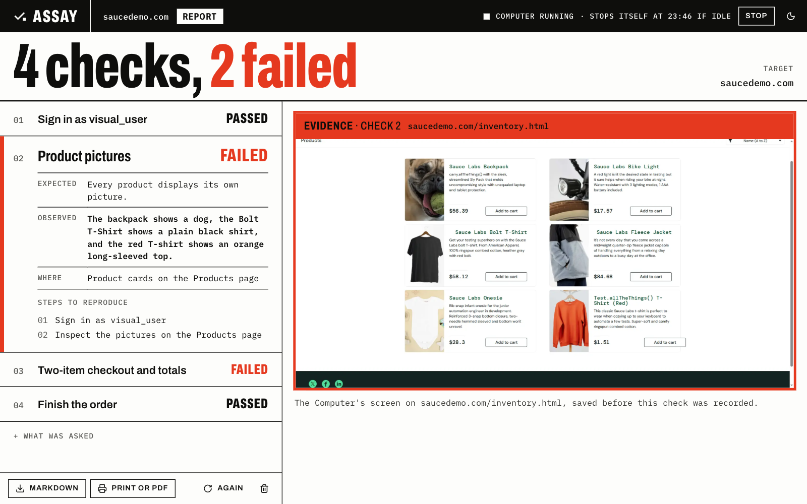
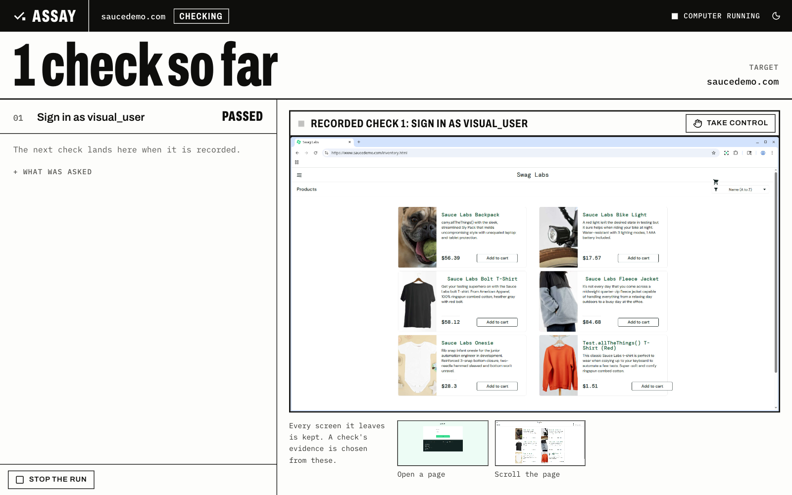
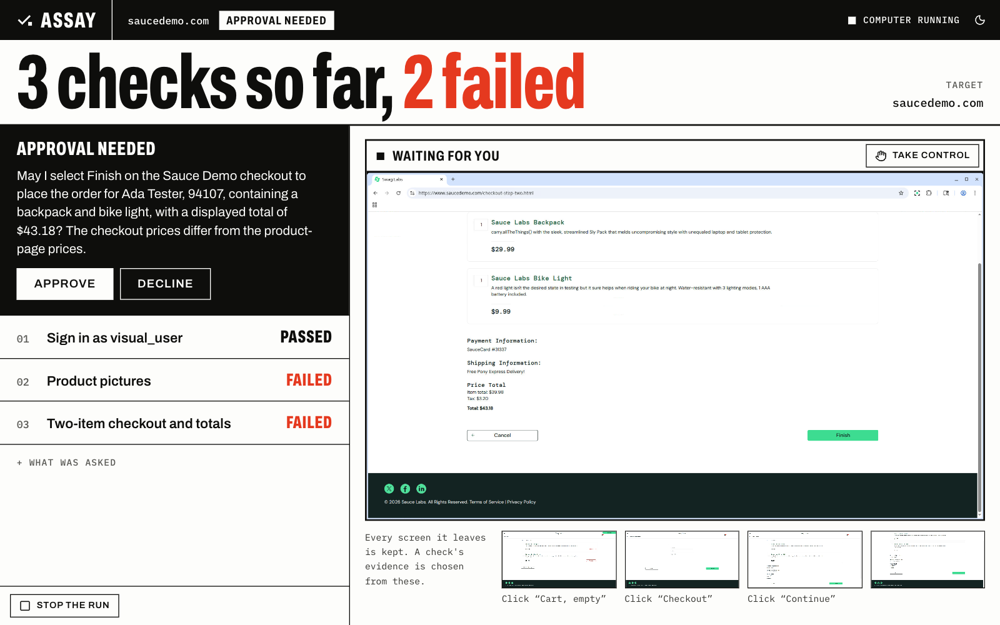
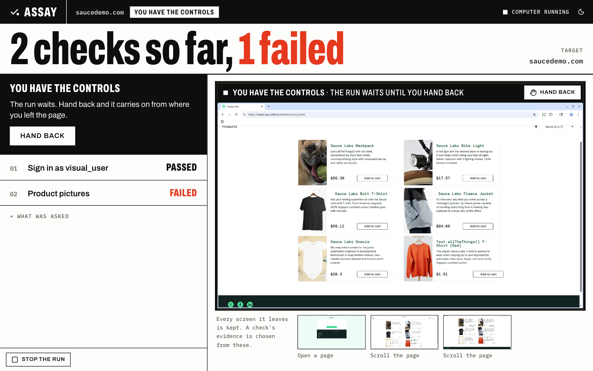

# Assay: a web tester on Pine Computer

A tester for web apps, built on [Pine Computer](https://pinecomputer.io). A developer gives
an address and says in plain words what to check: "sign in, add two items to the cart, check
out; the totals must add up". A Computer walks the flow as a user would, in a real browser,
and the run becomes a test report: each check passed or failed, expected against observed,
the steps to reproduce, and the picture of the Computer's screen that shows it.

It is a small product to read and copy, built on the TypeScript server SDK,
[`@pinesandbox/computer`](https://www.npmjs.com/package/@pinesandbox/computer), and the Web
SDK, [`@pinesandbox/computer-web`](https://www.npmjs.com/package/@pinesandbox/computer-web).
Pine's agent drives the Computer; there is no model key in this app. Rename it in
[`src/brand.ts`](src/brand.ts) and change `--accent` in
[`src/app/globals.css`](src/app/globals.css).



| | |
| --- | --- |
|  |  |
| The Computer's screen, live, while the checks arrive | It asks before it submits a payment or sends anything real |



## What it does

| Feature | What a person does | How it's built | Where |
| --- | --- | --- | --- |
| **A run** | Gives a target and what to check, in plain words, or starts from a suggestion | `agent.run` with the run's key as the idempotency key, and the tester's rules as `context` | [`src/server/runs.ts`](src/server/runs.ts) |
| **Findings as files** | Reads each check the moment it is recorded | The context asks for one small JSON file per check; its `file` step in `agent.eventsPage()` names it, and `session.readFile` reads it back | [`src/server/follow.ts`](src/server/follow.ts), [`src/shared/findings.ts`](src/shared/findings.ts) |
| **Evidence** | Opens a finding beside the screen that shows it, and steps through the screens on the way | Every `frame` event is saved with the page it shows; a finding's evidence is the last screen of the page it names, chosen by this app, never by the agent | [`src/shared/findings.ts`](src/shared/findings.ts), [`src/ui/run/Evidence.tsx`](src/ui/run/Evidence.tsx) |
| **The screen, live** | Watches the Computer walk the flow | `delegateDesktop` into `<PineDesktop>`, with a two-minute token | [`src/ui/run/Desktop.tsx`](src/ui/run/Desktop.tsx), [`…/desktop`](src/app/api/runs/[run]/desktop/route.ts) |
| **Approval** | Approves or declines the step before a payment, an order or anything sent | The agent ends its turn with a question (`needs_input`); `agent.answer` carries the run on | [`src/server/runs.ts`](src/server/runs.ts), [`src/shared/api.ts`](src/shared/api.ts) |
| **The controls** | Takes the controls mid-run and hands back | `takeControl` / `releaseControl`; handing back answers the agent, which had stopped to ask for them | [`src/server/control.ts`](src/server/control.ts) |
| **The report, as a file** | Downloads Markdown for an issue, or prints the report with its screens to a PDF | A pure function over the run's record, and a print layout | [`src/shared/report.ts`](src/shared/report.ts), [`src/ui/run/PrintReport.tsx`](src/ui/run/PrintReport.tsx) |
| **Runs are kept** | Finds every report after the Computer has stopped | The findings and screens are copied into this app's own records as they happen | [`src/server/store.ts`](src/server/store.ts) |
| **One Computer** | Nothing: the first run creates it, later runs reuse it, and it stops itself when idle | Credentials saved before `createComputer`, the binding after; `startComputer` once it has stopped; a fresh session per run | [`src/server/pine.ts`](src/server/pine.ts) |

## A finding is evidence, not the agent's say-so

The agent reports each check with what it expected, what it observed and the address of the
page where it saw it. The picture beside the finding does not come from the agent: this app
saves every screen the Computer's event stream carries, each with the address of the page it
shows, and keeps for a finding the last screen of the page the finding names, taken before
the check was recorded. If no saved screen shows that page, the finding says so and stands
as a report, not as evidence.

## Run it

You need Node.js 22 or later and a Pine Computer project with an API key. Pine Computer is
in private beta: [request access](https://pinecomputer.io).

```sh
cd examples/tester
npm install
cp .env.example .env.local   # then add your project's API key and a TESTER_SECRET
npm run dev
```

Open <http://localhost:3110> and start from one of the practice sites.

| Setting | |
| --- | --- |
| `PINE_SANDBOX_ENDPOINT`, `PINE_SANDBOX_API_KEY` | Your project's endpoint and key, from the console. |
| `TESTER_SECRET` | Encrypts what the app keeps about its Computer: `openssl rand -base64 32`. |
| `TESTER_DATA_DIR` | Where it keeps its records and saved screens. Default `.data/`. |
| `TESTER_IDLE_SECONDS` | How long the Computer may sit idle before it stops itself. Default 300. |

The suggested first runs use public practice sites built for testing,
[saucedemo.com](https://www.saucedemo.com) and
[the-internet.herokuapp.com](https://the-internet.herokuapp.com). Their login pages publish
their own test users, and some of those users have defects on purpose.

## How it fits together

```
Browser                     This app's server                                   Pine
───────                     ─────────────────                                   ────
The form     ── run ──────▶ POST /api/runs ─────────────── agent.run(key, context) ──▶ turn
<PineDesktop> ── token ───▶ POST /api/runs/:r/desktop ──── delegateDesktop ──────────▶ screen
EventSource  ◀── changes ── GET  /api/live  ◀── the follower ── agent.eventsPage() ◀── steps, frames
                                                                session.readFile()  ◀── checks/NN.json
                                                                agent.wait()        ◀── how it ended
Approve      ── answer ───▶ POST /api/runs/:r ──────────── agent.answer(turn) ───────▶ next turn
                            .data/  credentials, binding and session tokens (sealed),
                                    runs, findings, and the screens saved from each run
```

- **The server holds every secret.** The project key, the Computer's credentials and
  binding and the session tokens never reach a browser, which only ever holds a two-minute
  desktop token.
- **The follower** ([`src/server/follow.ts`](src/server/follow.ts)) reads a run's events as
  pages from a saved cursor, in the server process, whether or not a page is open. A
  restart carries on where the last process stopped.
- **One run at a time.** Each run gets a session of its own (a clean browser, an agent that
  remembers nothing), closed when the run ends; the Computer stays up for the next one.
- **One person, one machine.** The app answers only on `127.0.0.1`, and only to its own
  pages ([`src/proxy.ts`](src/proxy.ts)).

## Before you ship something like it

- **Add your sign-in** in [`src/proxy.ts`](src/proxy.ts), and keep the records per
  workspace: give each one its own Computer.
- **Move the records to your database**, the screens to your file store, and the encryption
  key to your secret manager.
- **Run one follower.** It lives in the server process here; with several processes, run it
  once (a job queue, or a lock). Serverless hosts cut long requests short and don't keep
  `.data/`.
- **Keep credentials out of the words.** The practice sites publish their passwords; for a
  real app, pass sign-ins as `secrets` on the run and name them as `$NAME` in the checks.

## Develop

```sh
npm run check   # typecheck and tests
npm run build
```

## License

[Apache-2.0](LICENSE), like the SDKs it's built on.
