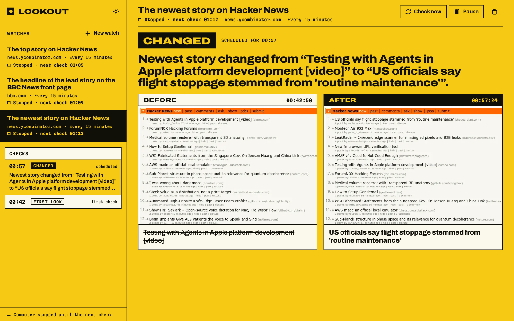
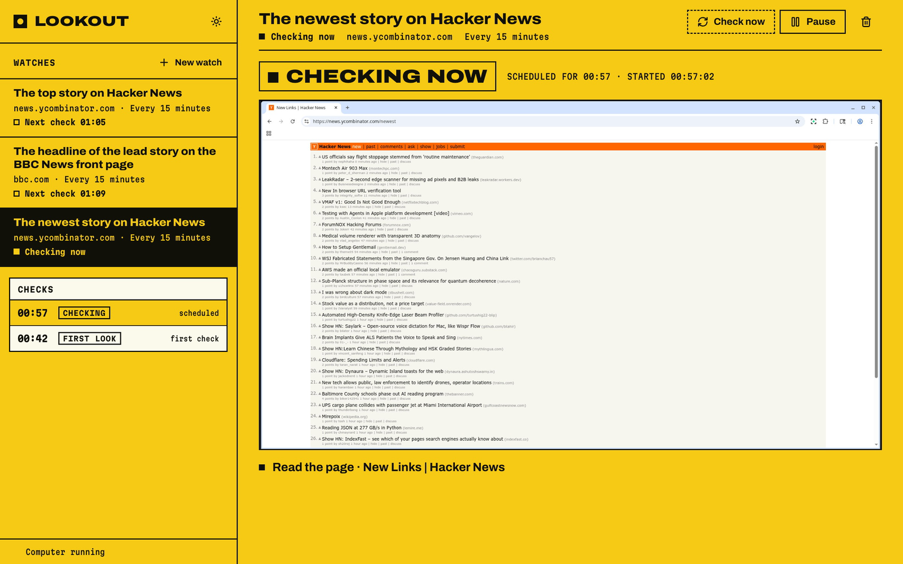
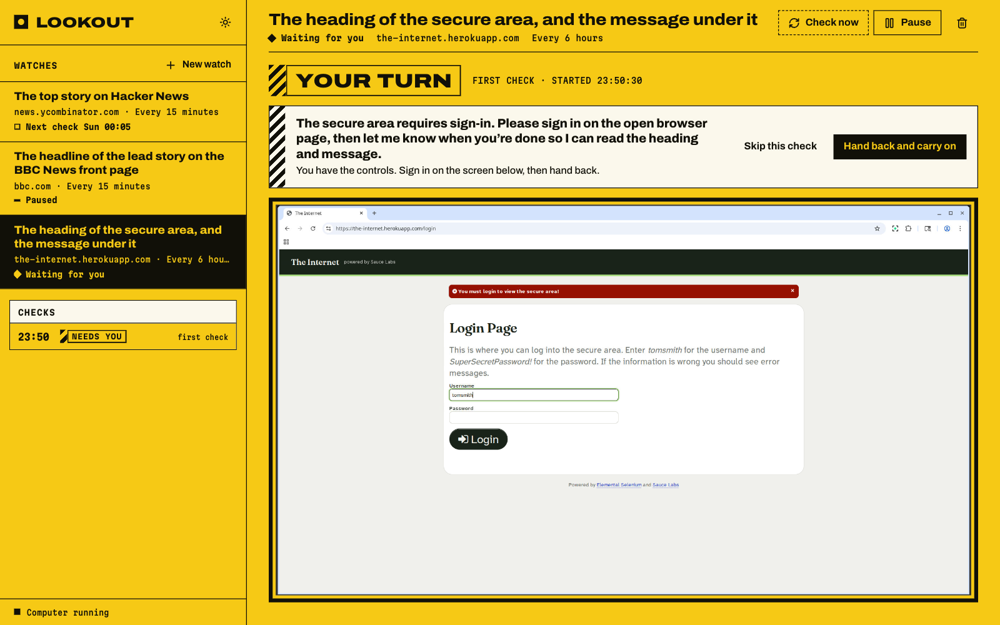

# Lookout: a watch desk on Pine Computer

Tell it what to watch on the web, in plain words, and how often: *the top story on Hacker
News*, *the pricing page: tell me when a price or a plan changes*. A
[Pine Computer](https://pinecomputer.io) opens the page in a real browser on that schedule,
as a person would, and a feed shows what changed, with the screen before and the screen after.

It ships as **Lookout**, a name to replace: rename it in [`src/brand.ts`](src/brand.ts),
change `--accent` in [`src/app/globals.css`](src/app/globals.css), and it's yours. It is
built from the [starter](../starter) on the TypeScript server SDK,
[`@pinesandbox/computer`](https://www.npmjs.com/package/@pinesandbox/computer), and the Web
SDK, [`@pinesandbox/computer-web`](https://www.npmjs.com/package/@pinesandbox/computer-web).



## What it does

| Feature | What a person does | How it's built | Where |
| --- | --- | --- | --- |
| **A watch, in plain words** | Says what to watch, where, and how often: every 15 minutes or more, or a time of day | A record in this app's store; its first check starts at once | [`src/server/watches.ts`](src/server/watches.ts), [`src/ui/NewWatch.tsx`](src/ui/NewWatch.tsx) |
| **Checks on a schedule** | Nothing: checks arrive in the feed with no page open | A worker in the server process starts the Computer for each due watch; the slot's time is the run's idempotency key, so a slot is checked once | [`src/server/worker.ts`](src/server/worker.ts), [`src/shared/cadence.ts`](src/shared/cadence.ts) |
| **A structured reading** | Sees the few things the check read, each under a name that stays the same | The goal asks Pine's agent for a short JSON reading and, from the second check on, for the same names again | [`src/server/reading.ts`](src/server/reading.ts) |
| **What changed** | Reads one sentence, with the two values and the two times | Two stored readings compared in this app, field by field; the agent never judges the change | [`src/server/reading.ts`](src/server/reading.ts), [`src/server/checks.ts`](src/server/checks.ts) |
| **Before and after** | Opens a change and sees both screens side by side, close up on the part that was read; a click shows the whole screen | The last picture in `agent.events()` is kept with each check, in this app's files | [`src/server/checks.ts`](src/server/checks.ts), [`src/ui/Change.tsx`](src/ui/Change.tsx) |
| **A check, live** | Watches the Computer's own screen, large, and the step it is on | `delegateDesktop` into `<PineDesktop>`; the step from `agent.events()` | [`src/ui/LiveCheck.tsx`](src/ui/LiveCheck.tsx), [`src/ui/Desktop.tsx`](src/ui/Desktop.tsx) |
| **Stopped between checks** | Sees it said plainly: "Stopped · next check 14:30" | The worker calls `computer.stop()` when no check is left, and `startComputer` for the next one | [`src/server/pine.ts`](src/server/pine.ts) |
| **Check now** | Asks for a check by hand; the feed says "checked by hand" | The same check with its own trigger and key; the schedule is left as it was | [`api/watches/[id]/check`](src/app/api/watches/[id]/check/route.ts) |
| **A page that needs a sign-in** | Takes the controls once, signs in on the Computer's screen, hands back | The agent's question ends the turn; `takeControl`, `releaseControl`, then `agent.answer` | [`src/server/checks.ts`](src/server/checks.ts), [`api/control`](src/app/api/control/route.ts) |
| **Pause, resume, delete** | Pauses a watch, resumes it at its next time, or deletes it with its history | Changes to the watch's record; a running check of a deleted watch is canceled | [`api/watches/[id]`](src/app/api/watches/[id]/route.ts) |

Everything changes live: the server pushes a note whenever a record changes and the page
reads the desk again.

## How a check works

1. **The worker fires it.** The Computer never wakes itself. Every few seconds the worker
   in this app's server looks for a watch that is due and opens a check for its slot.
2. **The Computer starts.** `startComputer` from the saved credentials (or `createComputer`,
   the first time), then a fresh session: a stopped Computer keeps no tabs and no session.
3. **Pine's agent looks.** The goal is the person's words, the page's address, and the
   names the last reading used. It answers with a short reading: named values, copied as
   the page shows them.
4. **This app keeps it.** The reading, the time and the last picture of the screen go into
   `.data/`. The reading is compared with the one stored before it: no change is one quiet
   line; a change is a sentence with before and after.
5. **The Computer stops.** With no check left, the worker stops it. The page says
   "Stopped · next check 14:30" until the worker starts it again.

A sign-in on the Computer may need repeating after it has been stopped. The product says
so where the person signs in.

## Run it

You need Node.js 22 or later and a Pine Computer project with an API key. Pine Computer
is in private beta: [request access](https://pinecomputer.io).

```sh
npm install
cp .env.example .env.local   # then add your project's API key and a WATCH_SECRET
npm run dev
```

Open <http://localhost:3130> and start a watch.

| Setting | |
| --- | --- |
| `PINE_SANDBOX_ENDPOINT`, `PINE_SANDBOX_API_KEY` | Your project's endpoint and key, from the console. |
| `WATCH_SECRET` | Encrypts what the app keeps about its Computer: `openssl rand -base64 32`. |
| `WATCH_DATA_DIR` | Where it keeps its records and each check's picture. Default `.data/`. |

## How it fits together

```
Browser                       This app's server                               Pine
───────                       ─────────────────                               ────
                              the worker ── a watch is due ── startComputer ──▶ the Computer
                                            agent.run(goal, slot key)       ──▶ a turn
                                            agent.events()                  ◀── steps, pictures
                                            agent.wait()                    ◀── the reading
                                            compare with the stored reading
                                            computer.stop()                 ──▶ stopped
EventSource   ◀── changes ─── GET  /api/live
the desk      ◀── records ─── GET  /api/app
<PineDesktop> ── token ─────▶ POST /api/desktop ── delegateDesktop ──────────▶ screen
                              .data/  credentials, binding and session token (sealed),
                                      watches, checks and their readings, screens/*.webp
```

- **The server holds every secret.** The project key and the Computer's credentials,
  binding and session token never reach a browser, which only ever holds a two-minute
  desktop token.
- **The history is this app's.** Readings, times and pictures live in `.data/`, so the
  comparison never depends on what a stopped Computer remembers.
- **One Computer, one check at a time.** A watch that comes due during another check waits
  its turn; a watch due within the minute keeps the Computer running.
- **A limit on running Computers is said plainly.** A scheduled check that can't get a
  Computer waits, says why on its watch, and tries again every two minutes for half an hour.
- **One person, one machine.** The app answers only on `127.0.0.1`, and only to its own
  pages ([`src/proxy.ts`](src/proxy.ts)).





## Before you ship something like it

- **Add your sign-in** in [`src/proxy.ts`](src/proxy.ts) and
  [`src/server/user.ts`](src/server/user.ts). Records are already kept per user.
- **Move the records to your database**, the pictures to your file store, and the
  encryption key to your secret manager.
- **Run one worker.** It lives in the server process here; with several processes, run it
  once (a job queue, or a lock). Serverless hosts cut long requests short and don't keep
  `.data/`.
- **Tell people.** This example has no notifications: a change is where your product
  sends its email or message.

## Develop

```sh
npm run check   # typecheck and tests
npm run build
```

## License

[Apache-2.0](LICENSE), like the SDKs it's built on.
